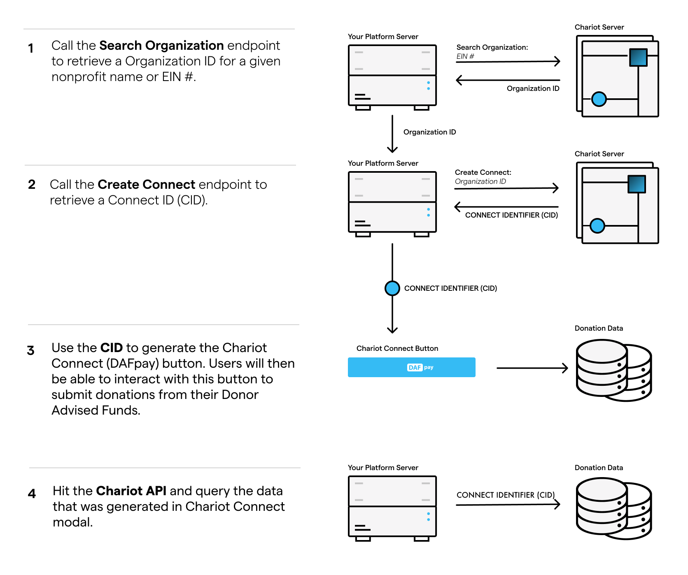
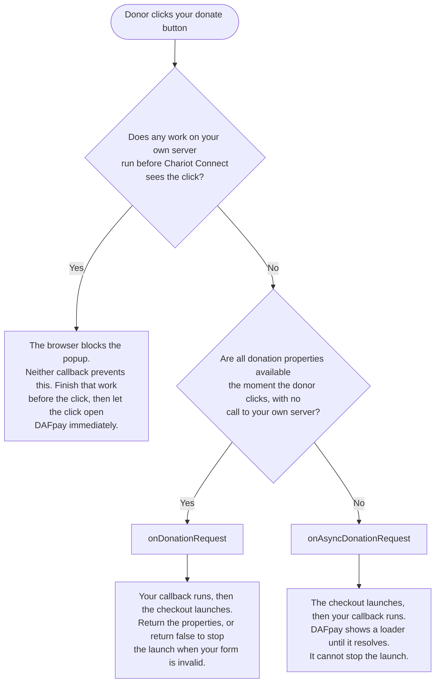
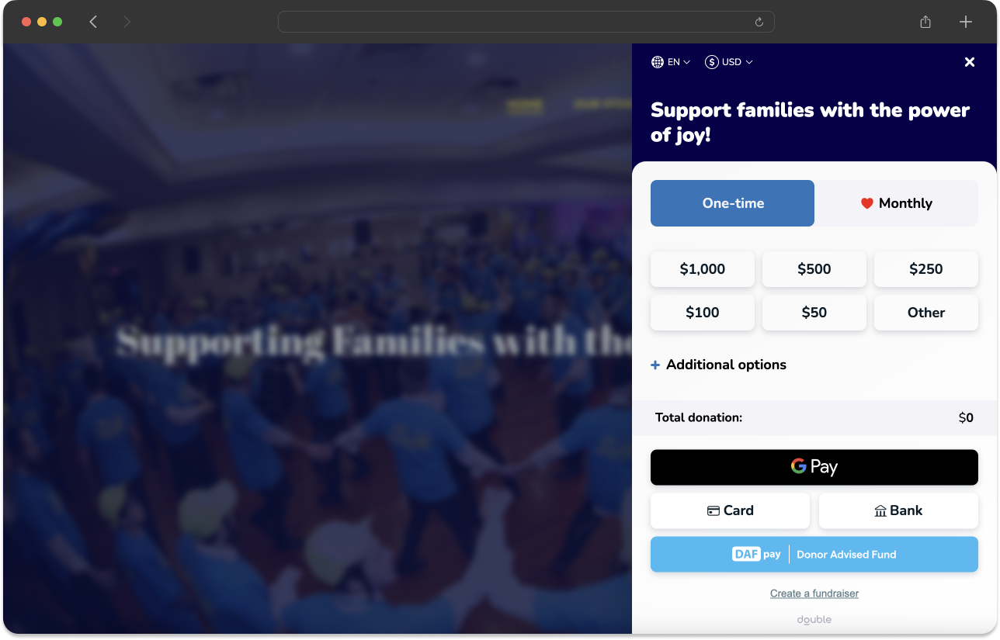
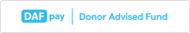

## Create Connects

<Note title="For Fundraising Platforms">
  This section is for fundraising platforms that serve many organizations and create a Connect for each one. If you are an organization integrating your own donation form, request a Connect ID from your Chariot implementation manager.
</Note>

Each organization on your platform has its own Connect. The Connect ID tells Chariot which organization should receive the Grant. Use the same search-and-create sequence for the organizations in your initial launch and for every organization that enables DAFpay afterwards.

Each organization needs a Chariot account before you can create its Connect. Send organizations that do not have one to your co-branded Chariot onboarding link to claim their account.

<Frame caption="Steps 1 and 2 are the per-organization setup covered in this section. Steps 3 and 4 are the donor flow, covered in the sections that follow.">
    
</Frame>

### Search for the Organization

Use [Search Organizations](/api/organizations/search) with the organization's EIN whenever possible. Names may be ambiguous, but EINs identify the legal organization.

<Tip title="Sandbox Testing">
  You can search for any valid EIN in sandbox, for example American Red Cross (53-0196605).
</Tip>

<EndpointRequestSnippet endpoint="GET /v1/organizations/search" />

If the organization is not returned or is ineligible, tell the organization they cannot accept DAF gifts through your platform yet, and contact [integrations@givechariot.com](mailto:integrations@givechariot.com) if the result is unexpected.

### Create the Connect

Call [Create Connect](/api/connects/create) with the Chariot organization ID and a contact email that belongs to the organization. Do not use your platform's support address.
<EndpointRequestSnippet endpoint="POST /v1/connects" />

Store the returned Connect ID on the corresponding organization record:

```text
platform_organization_id → chariot_organization_id → chariot_connect_id
```

Sandbox Connect IDs begin with `test_` and production Connect IDs begin with `live_`.

Create the Connect when the organization enables DAFpay, not during donor checkout. The call is idempotent: it returns the existing Connect for that organization on your platform. Send the contact email on repeat calls too.

### Create Connects at Scale

[Create Connect](/api/connects/create) allows about 50 requests per second and 10,000 per hour, and reports the limits in the response headers. For a large launch, create every Connect first, then turn on the button.

Read the Connect ID from the same organization record you use to render the form, and do not render DAFpay for an organization that has no Connect.

## Install DAFpay

Once you have the Connect, add the DAFpay button to your form. Load Chariot Connect directly from Chariot's CDN, rather than bundling or self-hosting it, and initialize it with the Connect ID stored for the nonprofit whose form the donor is viewing.

<CodeBlocks>
```html HTML
<script src="https://cdn.givechariot.com/chariot-connect.umd.js"></script>

<chariot-connect
  id="chariot"
  cid="NONPROFIT_CONNECT_ID"
  theme="LightModeTheme">
</chariot-connect>
```
```javascript React
// npm install --save react-chariot-connect
import ChariotConnect from "react-chariot-connect";

<ChariotConnect cid="NONPROFIT_CONNECT_ID" theme="LightModeTheme" />
```
</CodeBlocks>

### Component Attributes

| Attribute | Required | Default | What it does |
| --- | --- | --- | --- |
| `cid` | Yes | — | The Connect ID for the nonprofit receiving the gift. |
| `theme` | No | `DefaultTheme` | How the button looks. See [Styling](#styling). |
| `disabled` | No | `false` | Stops the checkout from launching. Use it to hold the button until your form is valid. |
| `context` | No | Chosen per browser and viewport | `iframe` or `popup`, overriding Chariot's choice. See [Where You Can Embed DAFpay](#where-you-can-embed-dafpay). |

Chariot Connect watches all four for changes after the component has rendered.

### Where You Can Embed DAFpay

DAFpay works on any domain and inside nested cross-origin iframes. You do not need to register a domain, and the checkout does not need third-party cookies or storage access.

By default, DAFpay opens a popup on mobile devices and in desktop Safari. When the button sits inside an iframe, it also opens a popup if that frame is not fully visible or its window is smaller than 390 by 640 pixels. Webviews always get the modal, and the `context` attribute overrides all of this.

### Content Security Policy

Chariot Connect loads its script from Chariot's CDN. Depending on the browser and viewport, DAFpay opens in a cross-origin frame or popup at `https://secure.dafpay.com`.

If your donation pages send a Content Security Policy, merge these sources into the applicable directives. The block below is an example, not a complete policy.

```text
Content-Security-Policy:
  default-src 'self';
  script-src 'self' https://cdn.givechariot.com;
  frame-src https://secure.dafpay.com;
  font-src 'self' https://cdn.givechariot.com;
  style-src 'self' 'unsafe-inline' https://cdn.givechariot.com;
  img-src 'self' https://cdn.givechariot.com data:;
```

The parent page does not need to add Chariot to `connect-src`. DAFpay API traffic originates inside the cross-origin frame.

If your security policy cannot allow inline styles, confirm the supported nonce or hash approach with Chariot before launch.

If your page sends a Permissions-Policy header, allow `publickey-credentials-get` and `publickey-credentials-create` for `https://secure.dafpay.com`, or passkey sign-in inside the checkout will fail.

If the button does not render or the modal does not open, see [Troubleshooting](/guides/dafpay/accept/troubleshooting).

### Prevent Blocked Popups

DAFpay must open in direct response to the donor's click. Keep the time between the click and the DAFpay window opening under one second.

Chariot Connect gives you two callbacks for passing form data, and which one you use decides when your code runs relative to the launch.



| Callback | When it runs | Use it when |
| --- | --- | --- |
| `onDonationRequest` | Before the checkout launches | Every donation property is available the moment the donor clicks and you do not need to call your own server. Returning `false` stops the checkout from launching, so this is where form validation belongs. |
| `onAsyncDonationRequest` | After the checkout has launched | You need to call your own server to build the donation properties or to record the intent. It cannot cancel the launch, and DAFpay shows a loader until it resolves. |

Returning a promise from `onDonationRequest` behaves like `onAsyncDonationRequest`: DAFpay launches first and resolves your promise into the open checkout, so the popup is not blocked. Reach for `onAsyncDonationRequest` when awaiting is what you mean.

If your platform uses a custom button or Shadow DOM, do not call your server between the donor's click and triggering DAFpay. That work runs before Chariot Connect sees the click, so neither callback can protect the popup. Complete the request first, then let the click open DAFpay immediately.

### Make DAFpay Easy to Find

<Tip title="About 10x More DAF Giving">
  Platforms that show DAFpay up front see about 10x more DAF giving: 9.0x on everyday forms and 10.7x on campaign forms.
</Tip>

For Express Checkout, place DAFpay near the amount selection alongside other primary payment methods.

For a multi-step form, show DAFpay on the first step or clearly indicate that Donor Advised Fund giving will be available later in the flow. Do not hide DAFpay behind a generic More or See more control unless the visible label tells donors that DAFpay or Donor Advised Fund giving is available.

<Frame>
    
</Frame>

<Warning title="Test the Placement">
  Check it at mobile widths and on every form and campaign type that supports DAFpay.
</Warning>

### Styling

`theme` is optional. Set it on the `chariot-connect` element to change how the DAFpay button looks.

You can style the button only. The checkout's branding and text are set by Chariot.

- `DefaultTheme`
- `LightModeTheme`
- `LightBlueTheme`
- `GradientTheme`

<Frame caption="DefaultTheme">
    
</Frame>

<Frame caption="LightModeTheme">
    
</Frame>

<Frame caption="LightBlueTheme">
    
</Frame>

<Frame caption="GradientTheme">
    
</Frame>

You can also register a custom theme:

```javascript
chariot.registerTheme("myTheme", {
  width: "w-12",
  height: "h-9",
  logoOverride: "DafpayExtended"
});
```

| Property | Use | Allowed value |
| --- | --- | --- |
| `width` | Button width | Numeric steps to `w-12`, fractions like `w-1/2`, or keywords like `w-full` |
| `height` | Button height | Numeric steps to `h-12`, or keywords like `h-full` |
| `logoOverride` | Button label | `"DafpayExtended"` for the longer label (the built-in `StandaloneTheme` uses it) |

## Capture Donation Data

With the button installed, use `onDonationRequest` to pass information from your donation form to DAFpay. If you need to call your own server first, use `onAsyncDonationRequest` instead; [Install DAFpay](/guides/dafpay/accept/adding-dafpay#prevent-blocked-popups) compares the two. Register the callback on the element you installed, once the component has loaded:

```javascript
const chariot = document.getElementById("chariot");

chariot.onDonationRequest(async () => ({
  amount: 25000,
  firstName: "Michael",
  lastName: "Scott",
  email: "michael@example.org",
  designation: "Community programs",
  metadata: {
    formId: "form_123",
    campaignId: "spring-2026"
  }
}));
```

### Supported Fields

| Field | Type | Notes |
| --- | --- | --- |
| `amount` | number | Amount in cents. Pass it when the donor selected an amount. If omitted, DAFpay may recommend an amount based on the available DAF balance. |
| `firstName` | string | Donor's first name. Truncated at 255 characters. |
| `lastName` | string | Donor's last name. Truncated at 255 characters. |
| `email` | string | Donor email. Truncated at 255 characters. |
| `phone` | string | Include the country code and omit special characters. Truncated at 255 characters. |
| `note` | string | Donor note to the nonprofit. Truncated at 400 characters. |
| `anonymous` | boolean | Whether the donor requested anonymity. Defaults to `false`. |
| `designation` | string | Truncated at 255 characters when stored, and at 100 when sent to the DAF provider. If you send none, the provider applies its own default, usually `Where needed most`. |
| `address` | object | Contains `line1`, `line2`, `city`, `state`, and `postalCode`. |
| `metadata` | object | Name-value pairs associated with the workflow session. Metadata is visible in the Chariot dashboard but is not shared with DAF providers. |
| `lockAmount` | boolean | Prevents the donor from changing the amount inside DAFpay. Defaults to `false`. |
| `fundId` | string | Preselects a DAF provider and skips the provider picker. |
| `frequency` | string | `ONE_TIME` or `MONTHLY`. Defaults to `ONE_TIME`. |

<Note title="Whole-Dollar Amounts">
  DAF Grants use whole-dollar amounts. DAFpay drops any cents, so 2550 opens as $25, and [Create Grant](/api/grants/create) rejects an `amount` that is not divisible by 100. Validate before you open DAFpay.
</Note>

There is no maximum-amount field. To enforce a maximum, set `lockAmount` or check the returned amount before you call Create Grant.

### What to Pass in Metadata

**Form identifiers:** Pass identifiers the nonprofit needs for CRM coding, such as campaign, appeal, designation, source, form, comment, dedication, and tribute data. You do not need to pass the page URL: Chariot records it on the Donation as `initiation.web_location_url`, including any tracking parameters already in it, such as a source or campaign code.

**Donor information:** For express checkout, you do not need to pass any donor information. DAFpay fills in the donor's details from their DAF account after they sign in and collects any required information that is missing from the provider within the modal. If your form collects donor details before showing the DAFpay button, pass them in `onDonationRequest` so the donor does not have to enter them twice.

**Purpose or designation:** You can pass the donor's designation in one of two places. In the top-level `designation` field, it is sent to the DAF provider with the Grant request (truncated at 100 characters). Some providers review a restricted designation before releasing the Grant, which can slow gift delivery time. You can instead pass a designation in metadata. In that case, the request stays unrestricted (the provider applies its own default purpose, usually "Where needed most") and your designation shows up in the Chariot dashboard.

Metadata can only be set in the browser. [Create Grant](/api/grants/create) has no metadata field, so anything you want stored on the gift has to be passed at this point and cannot be added or corrected from your server afterwards.

If your form allows a donor to divide one gift among multiple designations, you can use a custom object in the metadata to specify the breakdown between the designations.

```javascript
{
  amount: 60000,
  designation: "Community programs and General fund",
  metadata: {
    allocations: '[{"designationId":"community","amount":30000},{"designationId":"general","amount":30000}]'
  }
}
```

### Fees the Donor Covers

If your donation form allows a donor to cover fees, pass the increased amount including the fee to `onDonationRequest`. Since the processing fee is percent based, raising the amount will raise the fee. Grants must be in whole dollar increments, so round the total to the nearest whole dollar and compute the fee from that final amount.

Solve for the amount to capture:

$$P_{final} = \frac{P_{goal} + F_{fixed}}{1 - C_{percent}}$$

| Term | Meaning |
| --- | --- |
| $P_{final}$ | The final amount to capture |
| $P_{goal}$ | The amount the donor wanted the nonprofit to receive |
| $F_{fixed}$ | The fixed fee your platform charges on the grant |
| $C_{percent}$ | Chariot's percent fee per grant, for example `0.029` |

Tips are not permitted on DAF gifts, because DAF funds cannot go to a for-profit entity. Suppress any tip option when the donor selects DAFpay.

### Disable Until Validated

If your donation form has required fields, disable the DAFpay button until the form passes validation. Keep your own form validation and error messages alongside it, so the donor can see what to fix.

Setting the `disabled` attribute on the element will prevent the modal from launching. The button looks the same when disabled, so show your own validation messages.

```javascript
const chariot = document.getElementById("chariot");

function syncDafpayAvailability() {
  const amount = getAmountInCents();
  const ready = Number.isInteger(amount) && amount > 0 && amount % 100 === 0;
  chariot.toggleAttribute("disabled", !ready);
}
```

## Handle the Result

When the donor finishes in DAFpay, Chariot Connect tells your page what happened through three events.

| Event | When it fires | Detail |
| --- | --- | --- |
| `CHARIOT_INIT` | The component is initialized and ready | None |
| `CHARIOT_SUCCESS` | The donor authorized the request. This does not create the Grant or mean the nonprofit received the funds. Next, call [Create Grant](/api/grants/create) when the payload contains `grantIntent`, or [Create Recurring Grant](/api/recurring-grants/create) when it contains `recurringGrantIntent`. | `OnSuccessMetadata` |
| `CHARIOT_EXIT` | The donor exited, an error occurred, or an unintegrated Grant was confirmed | `OnExitMetadata` |

```javascript
const chariot = document.getElementById("chariot");

chariot.addEventListener("CHARIOT_INIT", () => {
  // The component is ready. Enable DAFpay.
});

chariot.addEventListener("CHARIOT_SUCCESS", ({ detail }) => {
  // Save the workflow session and create the Grant from your server.
});

chariot.addEventListener("CHARIOT_EXIT", ({ detail }) => {
  // Handle the exact value in detail.reason.
});
```

A one-time success payload has this shape. `user` holds the donor's details when Chariot has them:

```json
{
  "workflowSessionId": "79e772be-547d-4c9c-8b76-4ac4ed4c441a",
  "grantIntent": {
    "fundId": "bbf485dd-a056-4a9d-89a8-06e201cdbf7f",
    "amount": 2000,
    "trackingId": "7HX2KNQ4R8",
    "metadata": {}
  },
  "user": {
    "firstName": "Michael",
    "lastName": "Scott",
    "email": "michael@example.org"
  }
}
```

### On `CHARIOT_SUCCESS`

Associate `detail.workflowSessionId` with the current platform transaction, nonprofit, and Connect ID, and read the donor's details from `detail.user`.

Follow the steps on [Create the Grant](/guides/dafpay/accept/creating-grants#create-the-grant) to initiate the Grant.

### On `CHARIOT_EXIT`

`CHARIOT_EXIT` fires whenever a donor leaves the modal without an authorized grant intent. This includes normal exits back to your form, [unintegrated grant intents](/guides/dafpay/accept/creating-grants#unintegrated-providers), and error cases. See all exit reasons below:

| Reason | Meaning |
| --- | --- |
| `USER_EXIT` | The donor left the flow. If the donor closes the popup window, `detail` may carry only the reason, with no `workflowSessionId`. |
| `UNINTEGRATED_DAF` | The selected provider is not integrated with DAFpay. |
| `UNINTEGRATED_GRANT_CONFIRMED` | The donor confirmed an unintegrated Grant. Follow [Unintegrated DAF Providers](/guides/dafpay/accept/creating-grants#unintegrated-providers). |
| `UNINTEGRATED_DAF_NOT_SUPPORTED` | The selected provider does not support the unintegrated Grant flow. |
| `CID_NOT_FOUND` | The Connect ID was not found. |
| `SERVICE_DEACTIVATED` | The nonprofit's Connect is inactive. |
| `INELIGIBLE_ORGANIZATION` | The organization cannot receive DAF Grants. |
| `NONPROFIT_NOT_FOUND` | The provider does not support Grants to the nonprofit. |
| `CREDENTIALS_ERROR` | The provider credentials are invalid. |
| `TFA_VERIFICATION_ERROR` | Two-factor authentication failed. |
| `ACCOUNT_ACCESS_RESTRICTED` | Electronic access to the provider account is restricted. DAFpay explains this to the donor, so you do not need to. |
| `NO_CHARITABLE_ACCOUNTS` | The signed-in account has no charitable accounts. |
| `INVALID_PRESELECTED_DAF` | The supplied `fundId` is invalid. |
| `INVALID_CARD` | The card number is invalid. |
| `INACTIVE_CARD` | The card is inactive. |
| `ZERO_GRANT_AMOUNT` | The Grant amount is zero. |
| `RECURRING_NOT_SUPPORTED` | The provider does not support recurring Grants. |
| `CONNECTION_FAILED` | The connection to the provider failed. |
| `INSTITUTION_DOWN_ERROR` | The provider is unavailable. The donor should try again later. |
| `SESSION_NOT_FOUND` | The session was not found or has expired. |
| `BROWSER_NOT_SUPPORTED` | The donor's browser cannot run DAFpay. Offer another payment method. |
| `CUSTOM_ERROR` | A custom integration error occurred. |
| `INTERNAL_ERROR` | An internal error occurred. |
