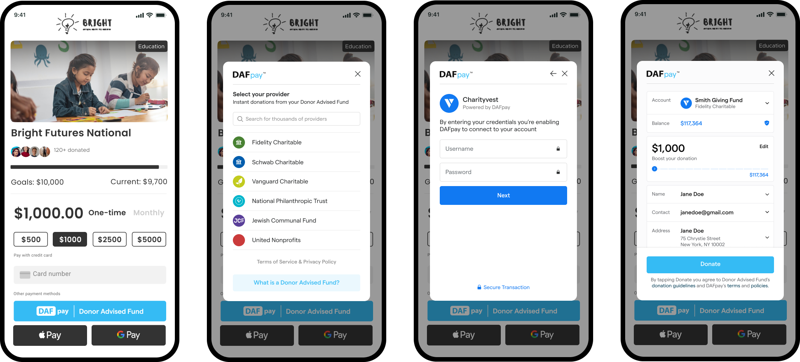

Follow this guide to build directly against the DAFpay APIs, whether you are adding DAFpay to one organization's donation form or offering it across forms for many organizations.

## How the integration works

1. Get the Connect for the organization receiving the gift. Chariot provides it if you are integrating one organization's form. If you serve many, you create one per nonprofit.
2. Render Chariot Connect using that organization's Connect ID.
3. Pass the current form values into DAFpay.
4. Receive `CHARIOT_SUCCESS` and create the Grant from your server within 15 minutes.
5. Store the workflow session, Grant, and reconciliation identifiers.
6. Subscribe to Grant updates.

## Use the SDK

Server-side calls are plain HTTP. The Node SDK wraps them with typed requests and responses, and handles paging and retries for you.

```sh
npm install --save @chariot-giving/typescript-sdk
```

See [SDKs](/api/sdks) for the full list.

## Data to store

Store your platform's nonprofit and transaction IDs, the Chariot organization ID, the Connect ID, the workflow session ID, and the Grant ID, plus the tracking and external Grant IDs once they arrive. [What to show](/guides/dafpay/accept/displaying-gifts#what-to-show) explains what each one is for.

Build against sandbox first. See [Authentication](/guides/dafpay/accept/authentication) for keys and base URLs.

Use the [integration checklist](/guides/dafpay/accept/checklist) to track your progress.

## Try DAFpay

Use the [DAFpay demo](https://secure.dafpay.com/demo) to see the donor experience before you begin.

Next: [Integration Checklist](/guides/dafpay/accept/checklist)
