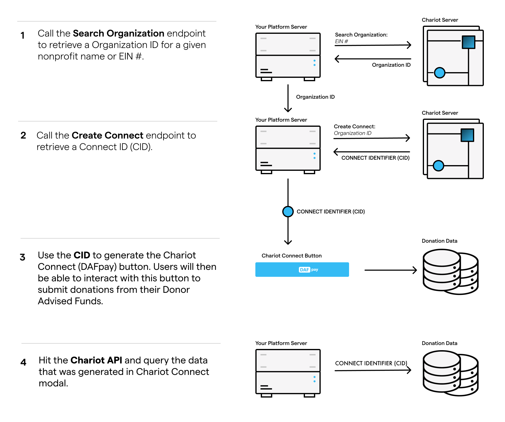

<Note title="For Fundraising Platforms">
  This page is for fundraising platforms that serve many organizations and create a Connect for each one. If you are an organization integrating your own donation form, Chariot provisions your sandbox and production Connects and sends you the IDs. Skip to [Install DAFpay](/guides/dafpay/accept/install).
</Note>

Each organization on your platform has its own Connect. The Connect ID tells Chariot which organization should receive the Grant. Use the same search-and-create sequence for existing eligible organizations included in your launch and all new organizations that DAFpay is enabled for.

Each organization needs a Chariot account before you can create its Connect. Send organizations that do not have one to your co-branded Chariot onboarding link first.

<Frame caption="Steps 1 and 2 are the per-organization setup covered on this page. Steps 3 and 4 are the donor flow, covered on the pages that follow.">
    
</Frame>

## Search for the Organization

Use Search Organizations with the organization's EIN whenever possible. Names may be ambiguous, but EINs identify the legal organization.

<Tip title="Sandbox Testing">
  You can search for any valid EIN in sandbox, for example American Red Cross (53-0196605).
</Tip>

<EndpointRequestSnippet endpoint="GET /v1/organizations/search" />

If the organization is not returned or is ineligible, do not create a placeholder or substitute another organization. Tell the user that the organization cannot accept DAF gifts through your platform yet, and contact [integrations@givechariot.com](mailto:integrations@givechariot.com) if the result is unexpected.

Your onboarding flow should also account for fiscal sponsors, organizations that change EINs, and users who select the wrong legal organization.

## Create the Connect

Call Create Connect with the Chariot organization ID and a contact email that belongs to the organization. Do not use your platform's support address.
<EndpointRequestSnippet endpoint="POST /v1/connects" />

Store the returned Connect ID on the corresponding organization record:

```text
platform_organization_id → chariot_organization_id → chariot_connect_id
```

Create the Connect when the organization enables DAFpay, not during donor checkout. The call is idempotent: it returns the existing Connect for that organization on your platform. Send the contact email on repeat calls too.

## Create Connects at Scale

Create Connect allows about 50 requests per second and 10,000 per hour, and reports the limits in the response headers. For a large launch, create every Connect first, then turn on the button.

## Prevent Tenant Mix-ups

Resolve the Connect ID from the same organization record used to render the form. Do not hardcode an ID, store it in process-wide mutable state, reuse the last value loaded, or fall back to a platform default.

If the organization has no enabled Connect, do not render DAFpay. Show the appropriate setup state in the organization's platform settings instead.

Next: [Install DAFpay](/guides/dafpay/accept/install)
