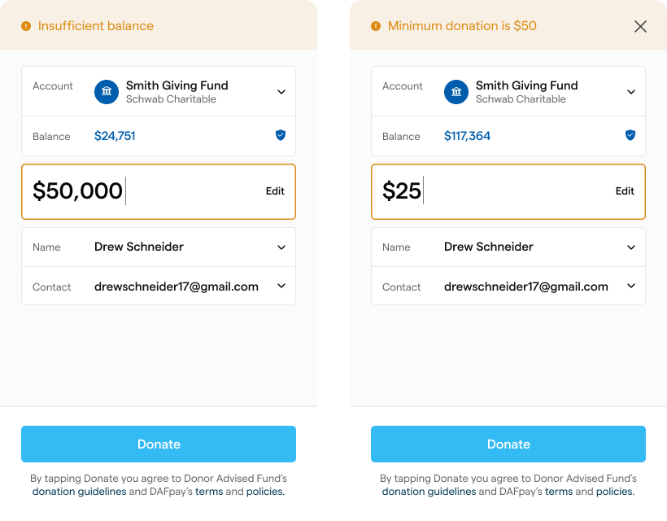

Call Create Grant from your server after `CHARIOT_SUCCESS` to submit the gift.

<EndpointRequestSnippet endpoint="POST /v1/grants" />

## Server-side sequence

1. Receive the workflow session ID and amount returned by DAFpay.
2. Resolve the nonprofit and platform transaction from your stored session record.
3. Save the platform transaction, and submit your own donation form first.
4. Call Create Grant with the server-side API key.
5. Store the Grant ID and response.

Submit your own form before calling Create Grant. If your form fails after the Grant exists, the donor sees an error for a gift that was actually submitted to their DAF provider, and there is no way for them to tell.

Complete this sequence within 15 minutes of authorization.

## Retry safely

Create Grant and Create Recurring Grant are both idempotent for a workflow session. If the first request times out, call the same endpoint again with the same `workflowSessionId`.

| Response | What to do |
| --- | --- |
| `201 Created` | The Grant was created. Store it and stop retrying. |
| `200 OK` | A Grant already exists for this workflow session. Store it and stop retrying. |
| `409 Conflict` | Submission for this session is already being processed. Wait, then retry with the same workflow session. |
| `410 Gone` | The authorization expired. Ask the donor to complete DAFpay again. |
| `400 Bad Request` | A value cannot be submitted. Read the error and handle the invalid amount, provider requirement, or fee. |
| `401` or `403` | Authentication or access failed. Check the API key, the environment, and account access. |

## A server-side example

Retry with the same `workflowSessionId`. Starting a new session creates a new authorization and can result in a duplicate gift.

```javascript
class CreateGrantError extends Error {
  constructor(status, body) {
    super(`Create Grant failed: ${status}`);
    this.status = status;
    this.body = body;
  }
}

async function createGrant({ workflowSessionId, amount, applicationFeeAmount }) {
  const deadline = Date.now() + 60_000;

  for (let attempt = 0; Date.now() < deadline; attempt++) {
    const controller = new AbortController();
    const timer = setTimeout(() => controller.abort(), 10_000);

    try {
      const res = await fetch(`${CHARIOT_BASE_URL}/v1/grants`, {
        method: "POST",
        headers: {
          Authorization: `Bearer ${CHARIOT_API_KEY}`,
          "Content-Type": "application/json"
        },
        body: JSON.stringify({ workflowSessionId, amount, applicationFeeAmount }),
        signal: controller.signal
      });

      // 201 created it, 200 means it already existed. Both are success.
      if (res.status === 201 || res.status === 200) return res.json();

      // Submission is still running, or the request is worth sending again.
      if (res.status === 409 || res.status >= 500) {
        await backoff(attempt);
        continue;
      }

      // 410 expired, 400 invalid, 401/403 wrong credentials. The caller decides.
      throw new CreateGrantError(res.status, await res.json().catch(() => null));
    } catch (err) {
      // A timed-out request may still have created the Grant. Ask again with the
      // same session: that is what the idempotency contract is for.
      if (err.name === "AbortError") {
        await backoff(attempt);
        continue;
      }
      throw err;
    } finally {
      clearTimeout(timer);
    }
  }

  throw new CreateGrantError(408, null);
}

const backoff = (attempt) =>
  new Promise((r) => setTimeout(r, 2 ** attempt * 500 + Math.random() * 250));
```

## Amount validation

Use the amount returned by `CHARIOT_SUCCESS`. It is in cents and must be a whole-dollar amount, divisible by 100. Create Grant rejects anything else, so validate the amount before you open DAFpay.

Do not set a universal minimum for DAFpay. Minimum Grant amounts vary by provider, and DAFpay prompts the donor to adjust an amount that is below the selected provider's minimum or above their available balance.

<Frame>
    
</Frame>

Create Grant may still return a validation error if the final amount cannot be submitted. Handle that error without marking the transaction complete.

## Platform fees

Use `applicationFeeAmount` only for the platform fee defined in your Chariot agreement. It is denominated in cents.

Create Grant validates `applicationFeeAmount` on its own against the Grant amount. The default ceiling is 210 basis points, and your Chariot agreement can raise it for your application. Chariot's own fee is charged separately and is not part of this check.

A donor-covered fee increases the Grant amount. It is not a separate tip. Do not offer a tip to a for-profit platform in a DAF transaction.

Next: [Unintegrated Providers](/guides/dafpay/accept/unintegrated)

