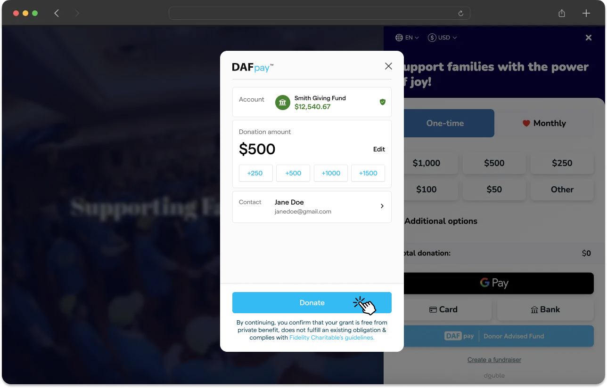
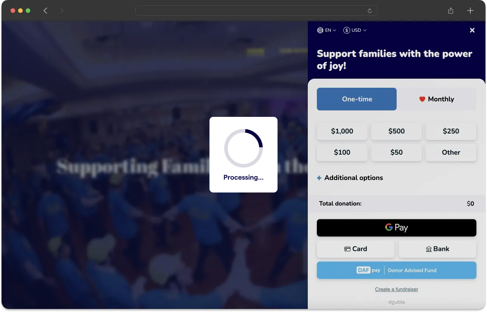
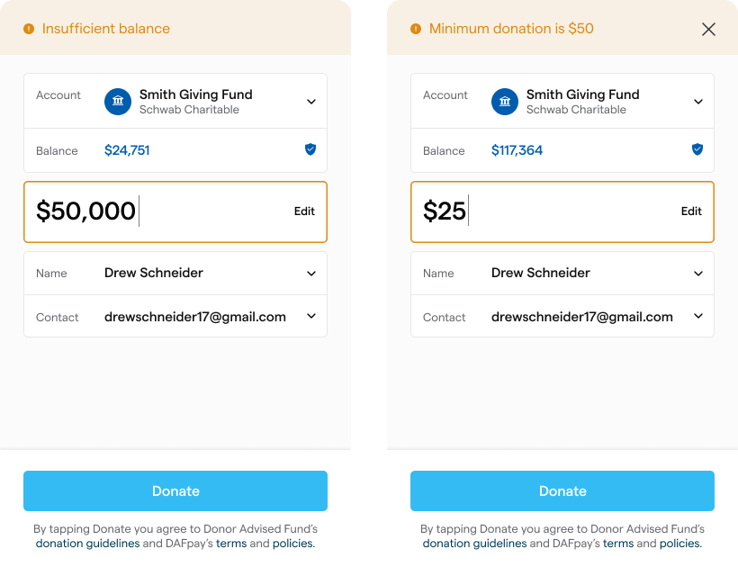
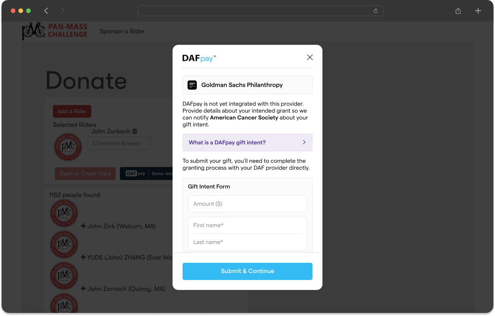
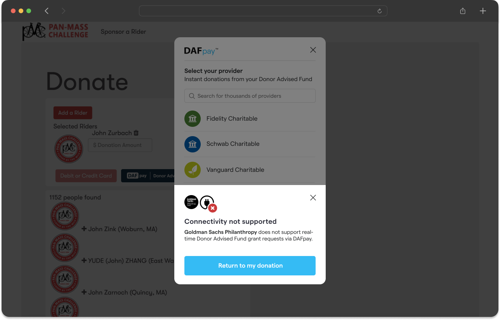
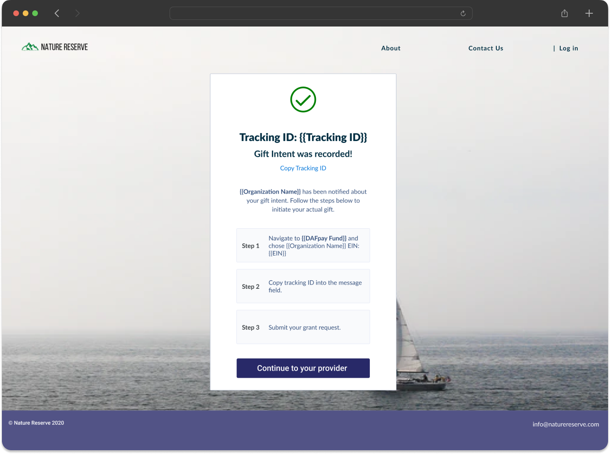
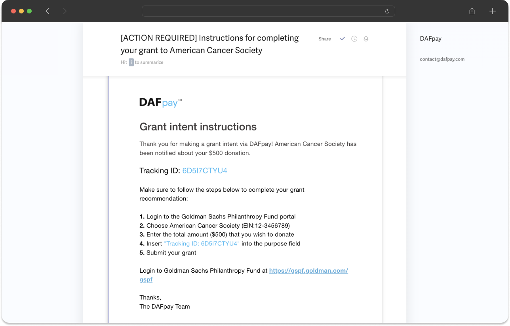

## Create the Grant

Once `CHARIOT_SUCCESS` fires, call [Create Grant](/api/grants/create) from your server to submit the gift. The call is made with your server-side credentials, never from the browser; see [Authentication](/api/authentication) for keys and base URLs.

<EndpointRequestSnippet endpoint="POST /v1/grants" />

### Server-Side Sequence

1. Receive the workflow session ID and amount returned by DAFpay.
2. Resolve the nonprofit and platform transaction from your stored session record.
3. Save the platform transaction, and submit your own donation form first.
4. Call [Create Grant](/api/grants/create) with the server-side API key.
5. Store the Grant ID and response.

<Warning title="Submit Your Form First">
  If your form fails after the Grant exists, the donor sees an error for a gift that was already submitted to their DAF provider, with no way to tell.
</Warning>

Complete this sequence within 15 minutes of authorization.

**Loading screen:** Show a loading state while your server calls Create Grant, and show final success only once the Grant exists. If the request is queued for retry, show a pending message until Grant creation is confirmed.

<Frame caption="Loading screen example">
    
    
</Frame>

**Success screen:** A created Grant means the gift was successfully initiated, not that the funds were sent, so use language that says the Grant was submitted to their DAF provider. DAF donors are not eligible for tax receipts when recommending a Grant, so do not include receipt language in your success screen or confirmation emails.

### Retry Safely

[Create Grant](/api/grants/create) and [Create Recurring Grant](/api/recurring-grants/create) are both idempotent for a workflow session. If the first request times out, call the same endpoint again with the same `workflowSessionId`.

A `201` means the Grant was created and a `200` means one already existed for that session. Both are success, so store the Grant and stop retrying. Keep retrying only on a `409`, while submission is still in flight, and on a `502`, remembering that each `502` retry submits the gift to the provider again.

Stop and change what the donor sees on the rest. A `410` means the authorization expired without a Grant, so the donor has to complete DAFpay again. A `404` means the provider does not recognize the nonprofit and a `412` means the nonprofit cannot receive DAF gifts, so offer another payment method. Keep the donor's transaction pending until you know which of these happened, and never mark it complete on an error.

[Create Grant](/api/grants/create) lists every response it returns and what each one means.

### A Server-Side Example

<Warning title="Same Workflow Session">
  Retry with the same `workflowSessionId`. Starting a new session creates a new authorization and can result in a duplicate gift.
</Warning>

```javascript
class CreateGrantError extends Error {
  constructor(status, body) {
    super(`Create Grant failed: ${status}`);
    this.status = status;
    this.body = body;
  }
}

async function createGrant({ workflowSessionId, amount, applicationFeeAmount }) {
  const deadline = Date.now() + 60_000;

  for (let attempt = 0; Date.now() < deadline; attempt++) {
    const controller = new AbortController();
    const timer = setTimeout(() => controller.abort(), 10_000);

    try {
      const res = await fetch(`${CHARIOT_BASE_URL}/v1/grants`, {
        method: "POST",
        headers: {
          Authorization: `Bearer ${CHARIOT_API_KEY}`,
          "Content-Type": "application/json"
        },
        body: JSON.stringify({ workflowSessionId, amount, applicationFeeAmount }),
        signal: controller.signal
      });

      // 201 created it, 200 means it already existed. Both are success.
      if (res.status === 201 || res.status === 200) return res.json();

      // Submission is still running, or the request is worth sending again.
      if (res.status === 409 || res.status >= 500) {
        await backoff(attempt);
        continue;
      }

      // 410 expired, 400 invalid, 401/403 wrong credentials. The caller decides.
      throw new CreateGrantError(res.status, await res.json().catch(() => null));
    } catch (err) {
      // A timed-out request may still have created the Grant. Ask again with the
      // same session: that is what the idempotency contract is for.
      if (err.name === "AbortError") {
        await backoff(attempt);
        continue;
      }
      throw err;
    } finally {
      clearTimeout(timer);
    }
  }

  throw new CreateGrantError(408, null);
}

const backoff = (attempt) =>
  new Promise((r) => setTimeout(r, 2 ** attempt * 500 + Math.random() * 250));
```

### Amount Validation

Use the amount returned by `CHARIOT_SUCCESS` rather than the amount your form collected. A donor who selected \$75 on your form can change it to \$150 inside DAFpay, and the returned amount is the one they authorized.

The amount is in cents and must be a whole-dollar amount, divisible by 100. [Create Grant](/api/grants/create) rejects anything else, so validate it before you open DAFpay.

Do not set a universal minimum for DAFpay. Minimum Grant amounts vary by provider, and DAFpay prompts the donor to adjust an amount that is below the selected provider's minimum or above their available balance.

<Frame>
    
</Frame>

Create Grant may still return a validation error if the final amount cannot be submitted. Handle that error without marking the transaction complete.

### Platform Fees

Use `applicationFeeAmount` only for the platform fee defined in your Chariot agreement. It is denominated in cents.

[Create Grant](/api/grants/create) validates `applicationFeeAmount` on its own against the Grant amount. The default ceiling is 210 basis points, and your Chariot agreement can raise it for your application. Chariot's own fee is charged separately and is not part of this check.

A donor-covered fee increases the Grant amount. It is not a separate tip. Do not offer a tip to a for-profit platform in a DAF transaction.

## Unintegrated Providers

Some DAF providers cannot accept a Grant directly through DAFpay. Chariot sets one of two behaviors for your platform:

1. Return the donor to your form to choose another payment method.
2. Record the donor's intent and help them complete the Grant in the provider's portal.

<Frame caption="Left: record the donor's intent. Right: return the donor to your form to pick another payment method.">
    
    
</Frame>

### How the Confirmation Arrives

If unintegrated Grants are enabled and a donor selects an unintegrated DAF and submits their intent, Chariot calls the Create Unintegrated Grant endpoint and `CHARIOT_EXIT` fires with the reason `UNINTEGRATED_GRANT_CONFIRMED`.

The exit event's `detail` includes the nonprofit and the Unintegrated Grant Chariot created:

```json
{
  "reason": "UNINTEGRATED_GRANT_CONFIRMED",
  "workflowSessionId": "79e772be-547d-4c9c-8b76-4ac4ed4c441a",
  "nonprofit": { "name": "Example Nonprofit", "ein": "12-3456789" },
  "unintegratedGrant": {
    "id": "67d66b89-51a0-4f17-a7b3-18c5dbac5361",
    "workflowSessionId": "79e772be-547d-4c9c-8b76-4ac4ed4c441a",
    "trackingId": "7HX2KNQ4R8",
    "amount": 25000,
    "fundId": "bbf485dd-a056-4a9d-89a8-06e201cdbf7f",
    "firstName": "Michael",
    "lastName": "Scott",
    "email": "michael@example.org",
    "metadata": { "platformTransactionId": "txn_123" },
    "fund": {
      "id": "bbf485dd-a056-4a9d-89a8-06e201cdbf7f",
      "name": "Example Charitable",
      "redirectUrl": "https://provider.example.com/grants/new"
    }
  }
}
```

### Confirmation Experience

Listen for the `CHARIOT_EXIT` with the reason `UNINTEGRATED_GRANT_CONFIRMED` and show instructions to complete the Grant through their provider portal:

- the nonprofit's name and EIN, from `detail.nonprofit`
- the intended amount
- the DAF provider link
- the tracking ID with the `Tracking ID:` prefix and a copy control

<Frame caption="Unintegrated Grant confirmation page">
    
</Frame>

DAFpay also emails the donor these instructions.

<Frame caption="Unintegrated Grant donor instructions email">
    
</Frame>

### Unintegrated Grant Statuses

Unintegrated Grants are created with `status: Unknown`, which means the donor received instructions, not that they submitted the recommendation in their provider's portal. The status reaches `Completed` when the funds arrive, either in the nonprofit's Chariot account or marked received outside it, and `Canceled` if the gift is ruled out. `unintegrated_grant.updated` fires on every status change, and most Grants stay at `Unknown`.

<EndpointRequestSnippet endpoint="GET /v1/unintegrated_grants" />

## Recurring Grants

A donor can set up a monthly recurring Grant from their donor advised fund. `MONTHLY` is the only supported frequency.

### The Provider Runs the Schedule

Chariot records that the donor set the gift up monthly. The DAF provider issues each month's Grant, and the donor changes or cancels it in their provider's portal, so Chariot is not notified and does not create a Grant each month. Reconcile the later Donations individually.

### Create the Recurring Grant

When the donor sets up a recurring gift, `CHARIOT_SUCCESS` carries a `recurringGrantIntent` in place of the `grantIntent`:

```json
{
  "workflowSessionId": "79e772be-547d-4c9c-8b76-4ac4ed4c441a",
  "recurringGrantIntent": {
    "fundId": "bbf485dd-a056-4a9d-89a8-06e201cdbf7f",
    "amount": 2000,
    "frequency": "MONTHLY",
    "metadata": {
      "platformTransactionId": "txn_123"
    }
  }
}
```

Call [Create Recurring Grant](/api/recurring-grants/create) rather than [Create Grant](/api/grants/create). An application fee applies to the first Grant only.

<EndpointRequestSnippet endpoint="POST /v1/recurring_grants" />

```javascript
const res = await fetch(`${CHARIOT_BASE_URL}/v1/recurring_grants`, {
  method: "POST",
  headers: {
    Authorization: `Bearer ${process.env.CHARIOT_API_KEY}`,
    "Content-Type": "application/json"
  },
  body: JSON.stringify({
    workflowSessionId: "79e772be-547d-4c9c-8b76-4ac4ed4c441a",
    frequency: "MONTHLY",
    amount: 2000
  })
});
```
