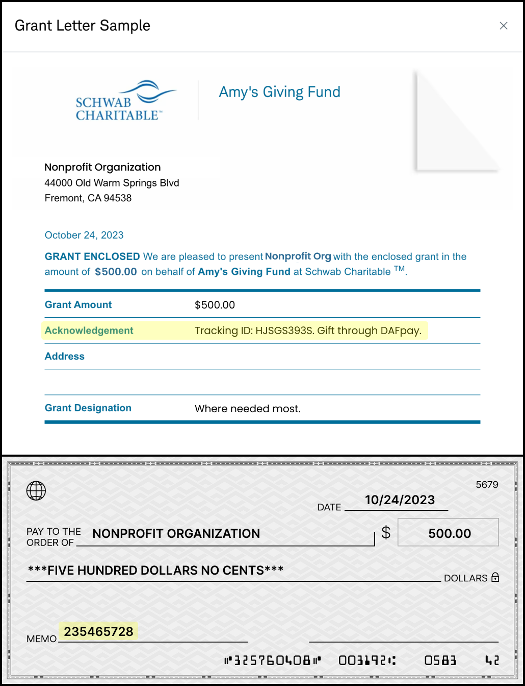
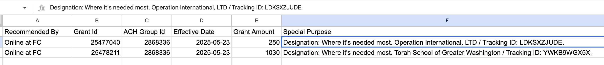

## Where DAFpay Funds Arrive

DAFpay submits the request but does not hold the donor's DAF funds. Gifts reach you the way that provider normally pays: electronically into your Chariot account for providers Chariot is connected to, and directly to your organization by ACH or check for the rest.

On a gift the provider pays you directly, their own remittance carries the DAFpay identifiers. These examples show where the tracking ID and the "Gift via DAFpay" callout appear in the memo, which is what your gift processing team matches against.

<Frame caption="A check grant paid directly to the nonprofit. The DAF provider pays you; DAFpay does not handle the funds on this route.">
    
</Frame>

<Frame caption="A Fidelity grant paid directly, showing the same DAFpay identifiers in the provider's remittance.">
    
</Frame>

Use the Grant's `fundId` with [Get DAF](/api/donor-advised-funds/get) when you need to show the provider name. Store the fund ID, but do not display it on its own. Retrieve and display the fund's human-readable name, such as Fidelity Charitable or DAFgiving360.

Next: [Displaying DAFpay Gifts](/guides/dafpay/accept/displaying-gifts)
