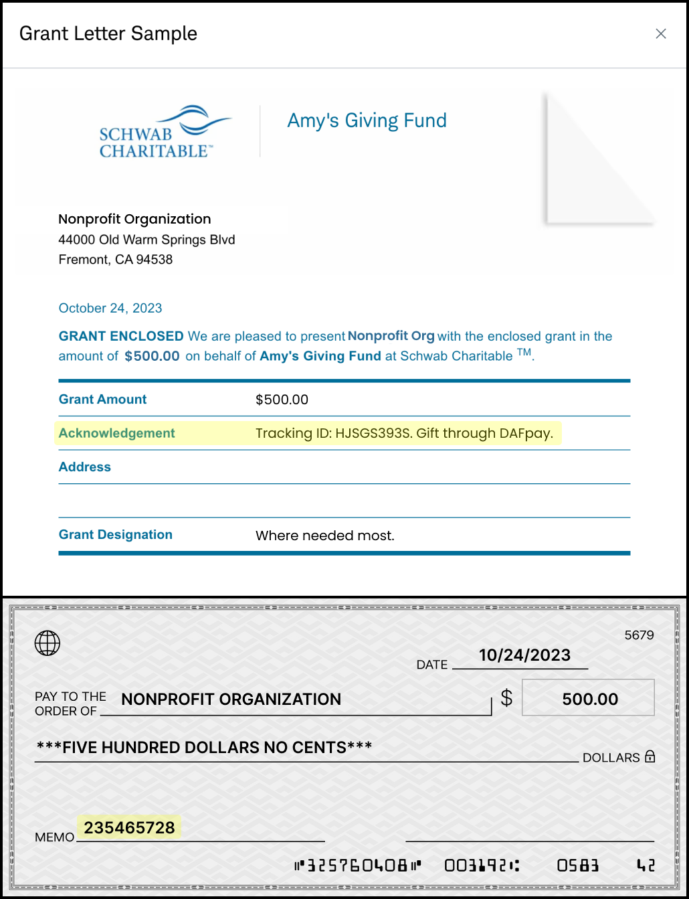
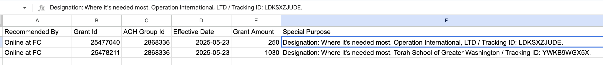

## Where DAFpay Funds Arrive

DAFpay submits the request but does not hold the donor's DAF funds. Funds are sent the way that provider normally pays. Timing varies by route and provider, from a few days to several weeks.

Gifts reach the nonprofit one of two ways:

| Route | When it applies | How the funds arrive | Grant marked Completed |
| --- | --- | --- | --- |
| Electronically to Chariot Deposit Account | The provider pays through one of Chariot's disbursement partners, or the nonprofit linked the provider to its Chariot account | Electronically into the nonprofit's Chariot account | Automatically |
| Outside of Chariot | Unlinked provider | ACH or check to the nonprofit | When the nonprofit marks it Received in the Chariot dashboard |

On a gift the provider pays you outside of Chariot, their own remittance carries the DAFpay identifiers. These examples show where the Tracking ID appears in the memo, usually as "Tracking ID {id} - Gift through DAFpay". Wording varies by provider.
<Frame caption="A check grant paid directly to the nonprofit. The DAF provider pays you; DAFpay does not handle the funds on this route.">
    
</Frame>

<Frame caption="A Fidelity grant paid directly, showing the same DAFpay identifiers in the provider's remittance.">
    
</Frame>
