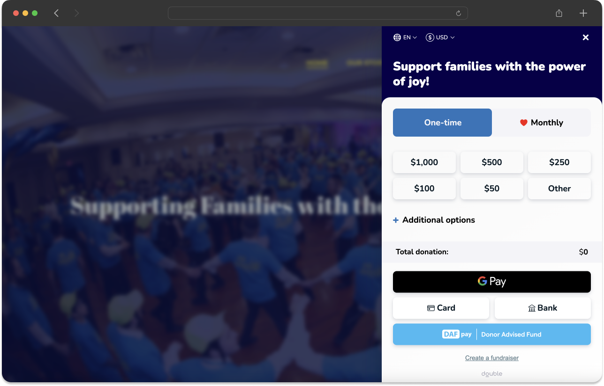

Once you have the Connect, add the DAFpay button to your form. Load Chariot Connect directly from Chariot's CDN, rather than bundling or self-hosting it, and initialize it with the Connect ID stored for the nonprofit whose form the donor is viewing.

<CodeBlocks>
```html HTML
<script src="https://cdn.givechariot.com/chariot-connect.umd.js"></script>

<chariot-connect
  id="chariot"
  cid="NONPROFIT_CONNECT_ID"
  theme="LightModeTheme">
</chariot-connect>
```
```javascript React
// npm install --save react-chariot-connect
import ChariotConnect from "react-chariot-connect";

<ChariotConnect cid="NONPROFIT_CONNECT_ID" theme="LightModeTheme" />
```
</CodeBlocks>

## Component Attributes

| Attribute | Required | Default | What it does |
| --- | --- | --- | --- |
| `cid` | Yes | — | The Connect ID for the nonprofit receiving the gift. |
| `theme` | No | `DefaultTheme` | How the button looks. See [Styling](#styling). |
| `disabled` | No | `false` | Stops the checkout from launching. Use it to hold the button until your form is valid. |
| `context` | No | Chosen per browser and viewport | `iframe` or `popup`, overriding Chariot's choice. See [Where You Can Embed DAFpay](#where-you-can-embed-dafpay). |

Chariot Connect watches all four for changes after the component has rendered.

## Where You Can Embed DAFpay

DAFpay works on any domain and inside nested cross-origin iframes. You do not need to register a domain, and the checkout does not need third-party cookies or storage access.

By default, DAFpay opens a popup on mobile devices and in desktop Safari. When the button sits inside an iframe, it also opens a popup if that frame is not fully visible or its window is smaller than 390 by 640 pixels. Webviews always get the modal, and the `context` attribute overrides all of this.

## Content Security Policy

Chariot Connect loads its script from Chariot's CDN. Depending on the browser and viewport, DAFpay opens in a cross-origin frame or popup at `https://secure.dafpay.com`.

If your donation pages send a Content Security Policy, merge these sources into the applicable directives. The block below is an example, not a complete policy.

```text
Content-Security-Policy:
  default-src 'self';
  script-src 'self' https://cdn.givechariot.com;
  frame-src https://secure.dafpay.com;
  font-src 'self' https://cdn.givechariot.com;
  style-src 'self' 'unsafe-inline' https://cdn.givechariot.com;
  img-src 'self' https://cdn.givechariot.com data:;
```

The parent page does not need to add Chariot to `connect-src`. DAFpay API traffic originates inside the cross-origin frame.

If your security policy cannot allow inline styles, confirm the supported nonce or hash approach with Chariot before launch.

If your page sends a Permissions-Policy header, allow `publickey-credentials-get` and `publickey-credentials-create` for `https://secure.dafpay.com`, or passkey sign-in inside the checkout will fail.

If the button does not render or the modal does not open, see [Troubleshooting](/guides/dafpay/accept/troubleshooting).

## Prevent Blocked Popups

DAFpay must open in direct response to the donor's click. Keep the time between the click and the DAFpay window opening under one second.

Chariot Connect gives you two callbacks for passing form data, and which one you use decides when your code runs relative to the launch.

| Callback | When it runs | Use it when |
| --- | --- | --- |
| `onDonationRequest` | Before the checkout launches | Every donation property is available the moment the donor clicks and you do not need to call your own server. Returning `false` stops the checkout from launching, so this is where form validation belongs. |
| `onAsyncDonationRequest` | After the checkout has launched | You need to call your own server to build the donation properties or to record the intent. It cannot cancel the launch, and DAFpay shows a loader until it resolves. |

Returning a promise from `onDonationRequest` behaves like `onAsyncDonationRequest`: DAFpay launches first and resolves your promise into the open checkout, so the popup is not blocked. Reach for `onAsyncDonationRequest` when awaiting is what you mean.

If your platform uses a custom button or Shadow DOM, do not call your server between the donor's click and triggering DAFpay. That work runs before Chariot Connect sees the click, so neither callback can protect the popup. Complete the request first, then let the click open DAFpay immediately.

## Make DAFpay Easy to Find

<Tip title="About 10x More DAF Giving">
  Platforms that show DAFpay up front see about 10x more DAF giving: 9.0x on everyday forms and 10.7x on campaign forms.
</Tip>

For Express Checkout, place DAFpay near the amount selection alongside other primary payment methods.

For a multi-step form, show DAFpay on the first step or clearly indicate that Donor Advised Fund giving will be available later in the flow. Do not hide DAFpay behind a generic More or See more control unless the visible label tells donors that DAFpay or Donor Advised Fund giving is available.

<Frame>
    
</Frame>

<Warning title="Test the Placement">
  Check it at mobile widths and on every form and campaign type that supports DAFpay.
</Warning>

## Styling

`theme` is optional. Set it on the `chariot-connect` element to change how the DAFpay button looks.

You can style the button only. The checkout's branding and text are set by Chariot.

- `DefaultTheme`
- `LightModeTheme`
- `LightBlueTheme`
- `GradientTheme`

<Frame caption="DefaultTheme">
    
</Frame>

<Frame caption="LightModeTheme">
    
</Frame>

<Frame caption="LightBlueTheme">
    
</Frame>

<Frame caption="GradientTheme">
    
</Frame>

You can also register a custom theme:

```javascript
chariot.registerTheme("myTheme", {
  width: "w-12",
  height: "h-9",
  logoOverride: "DafpayExtended"
});
```

| Property | Use | Allowed value |
| --- | --- | --- |
| `width` | Button width | Numeric steps to `w-12`, fractions like `w-1/2`, or keywords like `w-full` |
| `height` | Button height | Numeric steps to `h-12`, or keywords like `h-full` |
| `logoOverride` | Button label | `"DafpayExtended"` for the longer label (the built-in `StandaloneTheme` uses it) |
