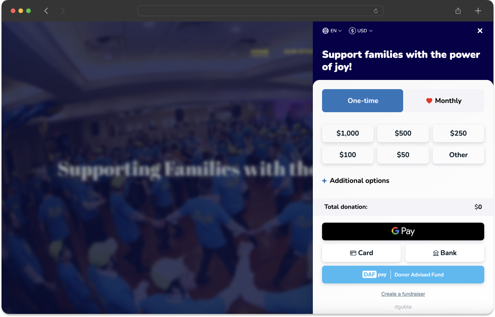
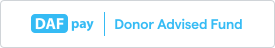

With a Connect ID in hand, add the DAFpay button to your form. Load Chariot Connect directly from Chariot's CDN, rather than bundling or self-hosting it, and initialize it with the Connect ID stored for the nonprofit whose form the donor is viewing.

<CodeBlocks>
```html HTML
<script src="https://cdn.givechariot.com/chariot-connect.umd.js"></script>

<chariot-connect
  id="chariot"
  cid="NONPROFIT_CONNECT_ID"
  theme="LightModeTheme">
</chariot-connect>
```
```javascript React
// npm install --save react-chariot-connect
import ChariotConnect from "react-chariot-connect";

<ChariotConnect cid="NONPROFIT_CONNECT_ID" theme="LightModeTheme" />
```
</CodeBlocks>

## Checkout Mode

By default, Chariot chooses whether the checkout opens as a modal on your page or in a popup window, based on the donor's browser and where the button is placed. To always use one mode, set the `context` attribute.

<CodeBlocks>
```html HTML
<chariot-connect id="chariot" cid="NONPROFIT_CONNECT_ID" context="popup"></chariot-connect>
```
```javascript React
<ChariotConnect
    cid="NONPROFIT_CONNECT_ID"
    context="popup"
/>
```
</CodeBlocks>

| Value | Behavior |
| --- | --- |
| `iframe` | Opens the checkout as a modal over your page. |
| `popup` | Opens the checkout in a separate browser window. |

<Note title="Buttons Inside an Iframe">
  In `iframe` mode the modal covers the frame the button is rendered in. If the button sits inside an iframe that is taller than the donor's screen, use `popup` or the default. Forcing `iframe` can break the checkout in Safari, on mobile devices, and in embedded forms. In `popup` mode, follow [Prevent Blocked Popups](#prevent-blocked-popups).
</Note>

## Where You Can Embed DAFpay

DAFpay works on any domain and inside nested cross-origin iframes. You do not need to register a domain, and the checkout does not need third-party cookies or storage access.

By default, DAFpay opens a popup on mobile devices and in desktop Safari. When the button sits inside an iframe, it also opens a popup if that frame is not fully visible or its window is smaller than 390 by 640 pixels. Webviews always get the modal, and the `context` attribute overrides all of this.

Chariot Connect does not emit open or close events, and its internal markup can change without notice, so do not build on it.

## Prevent Blocked Popups

DAFpay must open in direct response to the donor's click. Keep the time between the click and the DAFpay window opening under one second.

Load required data and validate nonprofit eligibility before the click. Avoid network requests, donation-history lookups, and other slow work inside `onDonationRequest`.

Return synchronously when you can. An async callback does not stop the window from opening, but DAFpay shows a loader until it resolves. Only a synchronous `false` cancels the launch.

If your platform uses a custom button or Shadow DOM, do not call your server between the donor's click and triggering DAFpay. Complete the request first, then let the click open DAFpay immediately.

## Make DAFpay Easy to Find

<Tip title="About 10x More DAF Giving">
  Platforms that show DAFpay up front see about 10x more DAF giving: 9.0x on everyday forms and 10.7x on campaign forms.
</Tip>

For Express Checkout, place DAFpay near the amount selection alongside other primary payment methods.

For a multi-step form, show DAFpay on the first step or clearly indicate that Donor Advised Fund giving will be available later in the flow. Do not hide DAFpay behind a generic More or See more control unless the visible label tells donors that DAFpay or Donor Advised Fund giving is available.

<Frame>
    
</Frame>

<Warning title="Test the Placement">
  Check it at mobile widths and on every form and campaign type that supports DAFpay.
</Warning>

## Styling

`theme` is optional. Set it on the `chariot-connect` element to change how the DAFpay button looks.

You can style the button only. The checkout's branding and text are set by Chariot.

- `DefaultTheme`
- `LightModeTheme`
- `LightBlueTheme`
- `GradientTheme`

<Frame caption="DefaultTheme">
    
</Frame>

<Frame caption="LightModeTheme">
    
</Frame>

<Frame caption="LightBlueTheme">
    
</Frame>

<Frame caption="GradientTheme">
    
</Frame>

You can also register a custom theme:

```javascript
chariot.registerTheme("myTheme", {
  width: "w-12",
  height: "h-9",
  logoOverride: "DafpayExtended"
});
```

| Property | Use | Allowed value |
| --- | --- | --- |
| `width` | Button width | Numeric steps to `w-12`, fractions like `w-1/2`, or keywords like `w-full` |
| `height` | Button height | Numeric steps to `h-12`, or keywords like `h-full` |
| `logoOverride` | Button label | `"DafpayExtended"` for the longer label (the built-in `StandaloneTheme` uses it) |

Next: [Capture Donation Data](/guides/dafpay/accept/donation-data)
