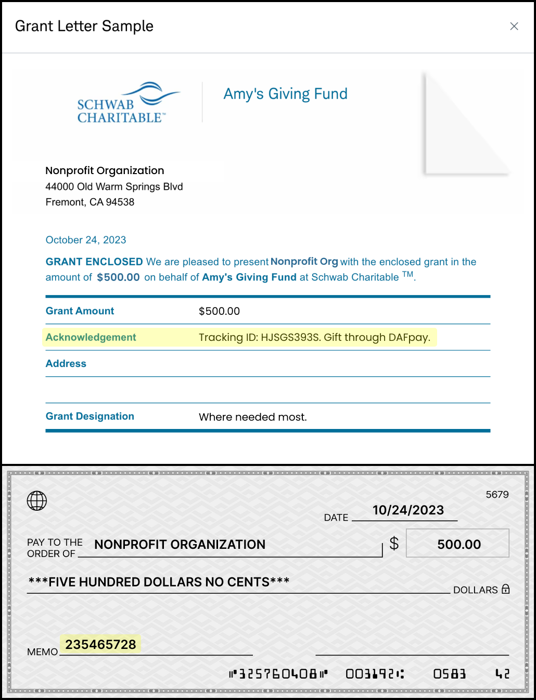
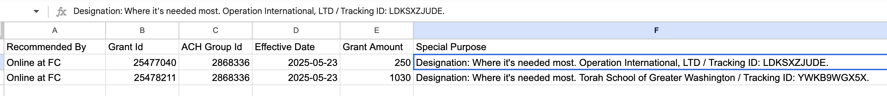

## Flow of Funds

### Where DAFpay Funds Arrive

DAFpay submits the request but does not hold the donor's DAF funds. Funds are sent the way that provider normally pays. Timing varies by route and provider, from a few days to several weeks.

Gifts reach the nonprofit one of two ways:

| Route | When it applies | How the funds arrive | Grant marked Completed |
| --- | --- | --- | --- |
| Electronically to Chariot Deposit Account | The provider pays through one of Chariot's disbursement partners, or the nonprofit linked the provider to its Chariot account | Electronically into the nonprofit's Chariot account | Automatically |
| Outside of Chariot | Unlinked provider | ACH or check to the nonprofit | When the nonprofit marks it Received in the Chariot dashboard |

On a gift the provider pays you outside of Chariot, their own remittance carries the DAFpay identifiers. These examples show where the Tracking ID appears in the memo, usually as "Tracking ID {id} - Gift through DAFpay". Wording varies by provider.
<Frame caption="A check grant paid directly to the nonprofit. The DAF provider pays you; DAFpay does not handle the funds on this route.">
    
</Frame>

<Frame caption="A Fidelity grant paid directly, showing the same DAFpay identifiers in the provider's remittance.">
    
</Frame>

## Displaying DAFpay Gifts

<Note title="For Fundraising Platforms">
  This section is for platforms offering DAFpay across many nonprofits' forms. If you are a nonprofit integrating your own donation form, read [Processing Donations](/guides/dafpay/accept/managing-gifts#processing-donations) below instead.
</Note>

The `trackingId` and `externalGrantId` allow a nonprofit to reconcile the funds to the initiated DAFpay grant when the funds arrive. Display both IDs prominently and searchable in your dashboard.

### What to Show

| Dashboard field | Grant field | Why the nonprofit needs it |
| --- | --- | --- |
| Tracking ID | `trackingId` | Match the gift to an incoming payment or remittance. |
| External Grant ID | `externalGrantId` | Match the provider's own grant or payment record. |
| Amount | `amount` | The submitted amount, converted from cents. |
| DAF provider | `fundId` | Use the Grant's `fundId` with [Get DAF](/api/donor-advised-funds/get) to display the fund's human-readable name, such as Fidelity Charitable or DAFgiving360. |
| Donor information | The donor fields you have | Identify the gift. |
| Grant status | `status` | The current state Chariot returns. |

<Note title="Missing Tracking IDs">
  Some DAF providers do not pass the Tracking ID through on their remittances, which is why the External Grant ID matters as a second route. When neither appears, the nonprofit falls back to the fund name, amount, date, and designation.
</Note>

### Keep the Records Current

Subscribe to `grant.created` and `grant.updated`. When an event arrives, retrieve the current Grant and update the existing transaction using the stored Grant ID. If you support unintegrated providers, subscribe to `unintegrated_grant.created` and `unintegrated_grant.updated` and read those through their own endpoints.

Display the status Chariot returns. Grant creation means the request was submitted to the provider. When the Grant moves to Completed, either automatically when the funds are recorded or when the nonprofit marks it received, update your transaction from the Grant update.

### Recording DAFpay Gifts

The funds in a DAF legally belong to the provider, so most nonprofits hard credit the DAF and soft credit the donor.

A DAFpay gift is initiated, not received. Record it in a pending state rather than as paid, and update it on `grant.updated` once the grant is received.

Expect nonprofits to ask whether DAFpay gifts sync automatically, and to want to review these records before they do.

### Cancellations and Refunds

A donor may be able to cancel a pending grant through their DAF provider before disbursement, subject to that provider's rules. Chariot does not have visibility if a donor cancels with their provider, but if the donor or nonprofit reaches out to Chariot, we can mark the gift as canceled. Your platform cannot cancel a Grant through the API.

## Processing Donations

<Note title="For Organizations">
  Donations represent gifts in Chariot and are only available to Chariot Deposit Account holders. If you are a platform offering DAFpay across many nonprofits' forms, read [Displaying DAFpay Gifts](/guides/dafpay/accept/managing-gifts#displaying-dafpay-gifts) above instead.
</Note>

Donations can be created from DAFpay gifts created via [Create Grant](/api/grants/create), or other gifts that land in an organization's account from a Chariot disbursement partner or a connected payment source. Building your gift processing around Donations allows you to use the same workflow for DAFpay gifts and gifts from your other connected payment sources.

<Tip>
  Every Grant has a Donation, but not every Donation has a Grant.
</Tip>

### Find the Donation

The donation record is created after the Grant. Once the Donation exists, its ID is added to the corresponding grant. This happens asynchronously, so `donationId` may not be present if you retrieve the Grant immediately.

Once the Donation exists, it behaves like any other gift in Chariot. [Donation Status](/guides/processing/donation-status) covers `payment_status`, settlement timestamps, retrieving donations, and writing your own status back.

### Match Payments Outside Chariot

Donations received in your Chariot Deposit Account are automatically tied to the DAFpay initiation. For donations received outside of Chariot, you can use the DAFpay tracking ID to search for the donation and update the status to `Received outside Chariot`.

| Identifier | Where to find it | Use |
| --- | --- | --- |
| Donation ID | Donation `id`, or the Grant's `donationId` | Update the same gift in your CRM. |
| DAFpay Tracking ID | Grant `trackingId`, or Donation `initiation.dafpay_tracking_id` | Match the provider's remittance to the initiated gift. |
| Provider Grant ID | Grant `externalGrantId` | Match the provider's own grant record when the tracking ID is absent. |
| Your transaction ID | `initiation.dafpay_metadata` | Find the original form submission. |

Some DAF providers do not pass the Tracking ID through on their remittances, which is why the External Grant ID matters as a second route. When neither appears, match on the donor's fund name, amount, date, and designation, and review an uncertain match before marking the Donation received. Some providers batch several gifts into one payment, so one payment can match more than one Donation.
