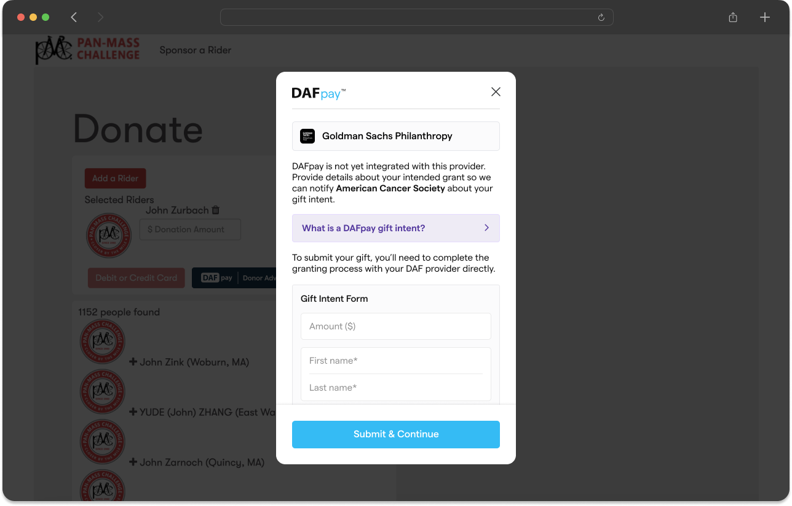
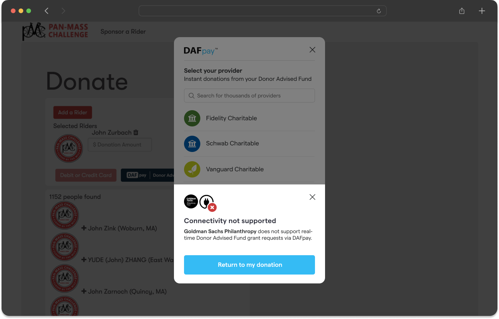
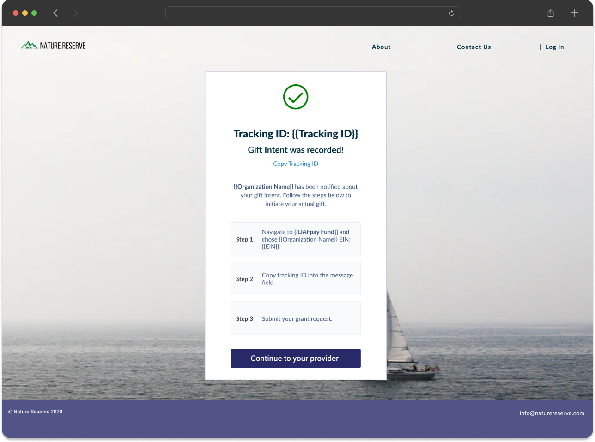
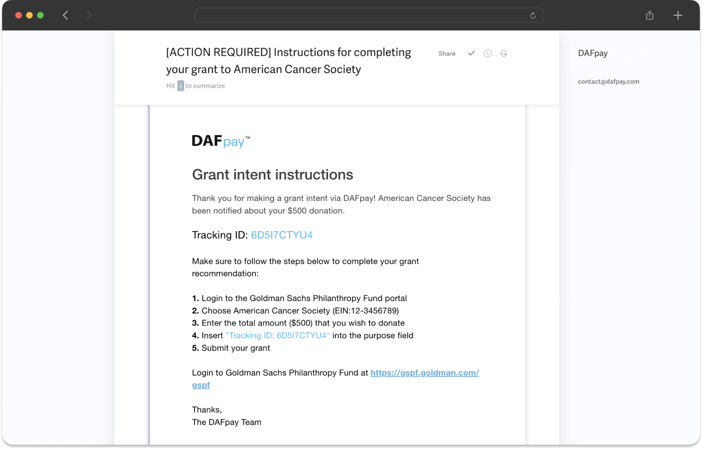

Some DAF providers cannot accept a Grant directly through DAFpay. Chariot sets one of two behaviors for your platform:

1. Return the donor to your form to choose another payment method.
2. Record the donor's intent and help them complete the Grant in the provider's portal.

The first sends `CHARIOT_EXIT` with `UNINTEGRATED_DAF`. Providers Chariot does not support at all always send `UNINTEGRATED_DAF_NOT_SUPPORTED`, whatever the setting.

<Frame caption="Left: record the donor's intent. Right: return the donor to your form to pick another payment method.">
    
    
</Frame>

## How the Confirmation Arrives

Confirming an unintegrated Grant is delivered as a `CHARIOT_EXIT` event with the reason `UNINTEGRATED_GRANT_CONFIRMED`, not as `CHARIOT_SUCCESS`. Handle it in your exit listener even though the donor completed the step.

Chariot has already created the Unintegrated Grant record by the time this event fires. There is no endpoint for you to call, and none is needed. You read Unintegrated Grants and subscribe to their events; you never create one.

## What the Event Carries

The exit event's `detail` includes the nonprofit and the Unintegrated Grant Chariot created:

```json
{
  "reason": "UNINTEGRATED_GRANT_CONFIRMED",
  "workflowSessionId": "79e772be-547d-4c9c-8b76-4ac4ed4c441a",
  "nonprofit": { "name": "Example Nonprofit", "ein": "12-3456789" },
  "unintegratedGrant": {
    "id": "67d66b89-51a0-4f17-a7b3-18c5dbac5361",
    "workflowSessionId": "79e772be-547d-4c9c-8b76-4ac4ed4c441a",
    "trackingId": "7HX2KNQ4R8",
    "amount": 25000,
    "fundId": "bbf485dd-a056-4a9d-89a8-06e201cdbf7f",
    "firstName": "Michael",
    "lastName": "Scott",
    "email": "michael@example.org",
    "metadata": { "platformTransactionId": "txn_123" },
    "fund": {
      "id": "bbf485dd-a056-4a9d-89a8-06e201cdbf7f",
      "name": "Example Charitable",
      "redirectUrl": "https://provider.example.com/grants/new"
    }
  }
}
```

Join it to your own record on its `workflowSessionId`, or on an identifier you passed in `metadata`. Store `unintegratedGrant.id` as well, because that is the key the `unintegrated_grant.updated` events arrive on and the ID you read the record back with.

Use `fund.redirectUrl` for the provider link and `fund.name` for the provider's name rather than showing the raw `fundId`.

## Confirmation Experience

When `CHARIOT_EXIT` has the reason `UNINTEGRATED_GRANT_CONFIRMED`, show:

- the nonprofit's name and EIN, from `detail.nonprofit`;
- the intended amount and designation;
- the DAF provider link; and
- the tracking ID with the `Tracking ID:` prefix and a copy control.

Tell the donor that they still need to submit the Grant through their provider and should include the complete tracking ID in the provider's note or purpose field.

<Frame caption="Unintegrated Grant confirmation page">
    
</Frame>

<Note title="Avoid Duplicate Confirmations">
  DAFpay also emails the donor these instructions. Check whether Chariot's own confirmation screen is on for your Connect before you build this page: with both on the donor sees two confirmations, and with both off they leave without a tracking ID. Chariot can turn the donor email off for your platform, and it is not sent when there is no donor email.
</Note>

<Frame caption="Unintegrated Grant donor instructions email">
    
</Frame>

An Unintegrated Grant's `status` is `Unknown`, `Initiated`, `Completed` or `Canceled`. `Unknown` is expected for this flow: the donor left DAFpay to finish the gift, so Chariot cannot confirm what happened unless the funds later arrive.

## The Unintegrated Grant Record

Unintegrated Grants carry no Chariot fee, and the funds usually go straight from the provider to the nonprofit.

No event fires when the donor clicks Continue to DAF provider. `UNINTEGRATED_GRANT_CONFIRMED` fires when the donor closes Chariot's confirmation screen, or right away if that screen is turned off for your platform.

`unintegrated_grant.updated` fires on every status change.

Use the unintegrated-grant resources and events in the API reference for this separate object type.

<EndpointRequestSnippet endpoint="GET /v1/unintegrated_grants" />

Next: [Recurring Grants](/guides/dafpay/accept/recurring-grants)
