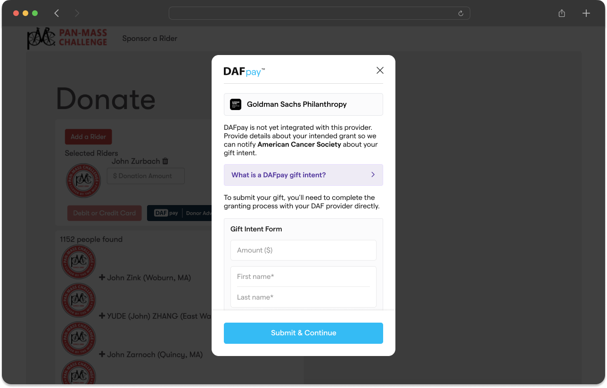
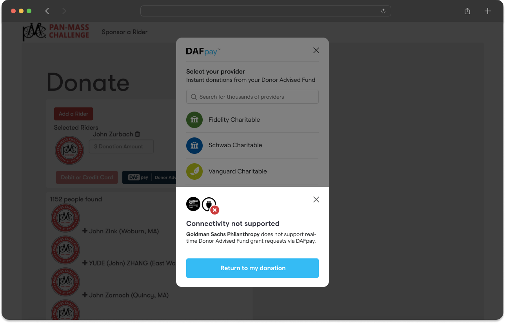
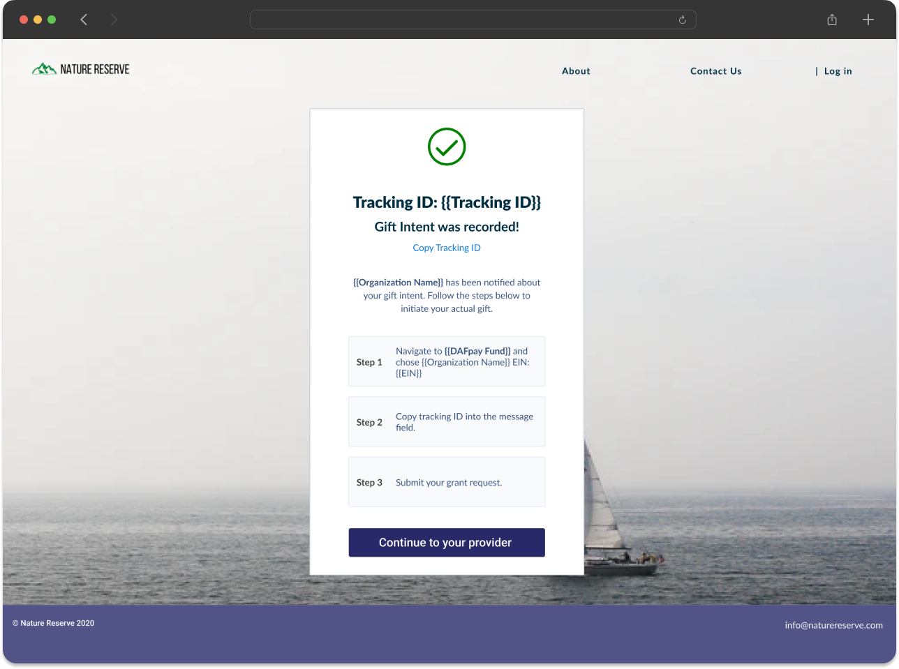
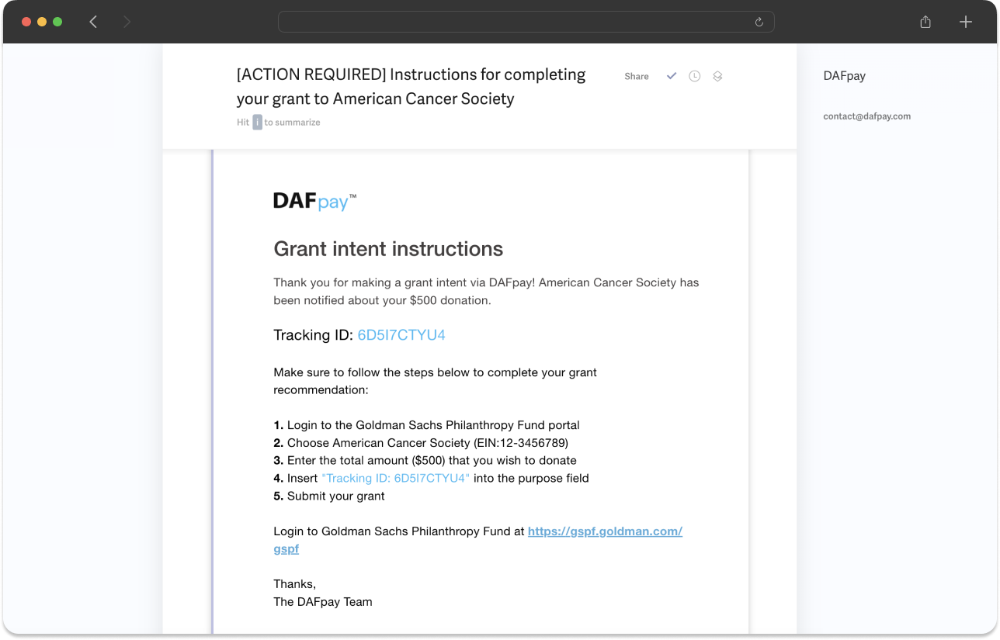

Some DAF providers cannot accept a Grant directly through DAFpay. Chariot sets one of two behaviors for your platform:

1. Return the donor to your form to choose another payment method.
2. Record the donor's intent and help them complete the Grant in the provider's portal.

<Frame caption="Left: record the donor's intent. Right: return the donor to your form to pick another payment method.">
    
    
</Frame>

## How the Confirmation Arrives

If unintegrated Grants are enabled and a donor selects an unintegrated DAF and submits their intent, Chariot calls the Create Unintegrated Grant endpoint and `CHARIOT_EXIT` fires with the reason `UNINTEGRATED_GRANT_CONFIRMED`.

The exit event's `detail` includes the nonprofit and the Unintegrated Grant Chariot created:

```json
{
  "reason": "UNINTEGRATED_GRANT_CONFIRMED",
  "workflowSessionId": "79e772be-547d-4c9c-8b76-4ac4ed4c441a",
  "nonprofit": { "name": "Example Nonprofit", "ein": "12-3456789" },
  "unintegratedGrant": {
    "id": "67d66b89-51a0-4f17-a7b3-18c5dbac5361",
    "workflowSessionId": "79e772be-547d-4c9c-8b76-4ac4ed4c441a",
    "trackingId": "7HX2KNQ4R8",
    "amount": 25000,
    "fundId": "bbf485dd-a056-4a9d-89a8-06e201cdbf7f",
    "firstName": "Michael",
    "lastName": "Scott",
    "email": "michael@example.org",
    "metadata": { "platformTransactionId": "txn_123" },
    "fund": {
      "id": "bbf485dd-a056-4a9d-89a8-06e201cdbf7f",
      "name": "Example Charitable",
      "redirectUrl": "https://provider.example.com/grants/new"
    }
  }
}
```

## Confirmation Experience

Listen for the `CHARIOT_EXIT` with the reason `UNINTEGRATED_GRANT_CONFIRMED` and show instructions to complete the Grant through their provider portal:

- the nonprofit's name and EIN, from `detail.nonprofit`
- the intended amount
- the DAF provider link
- the tracking ID with the `Tracking ID:` prefix and a copy control

<Frame caption="Unintegrated Grant confirmation page">
    
</Frame>

DAFpay also emails the donor these instructions.

<Frame caption="Unintegrated Grant donor instructions email">
    
</Frame>

## Unintegrated Grant Statuses

Unintegrated Grants are created with `status: Unknown`, since DAFpay does not have visibility into whether the donor completed the Grant in their provider's portal. `unintegrated_grant.updated` fires on every status change.

<EndpointRequestSnippet endpoint="GET /v1/unintegrated_grants" />
