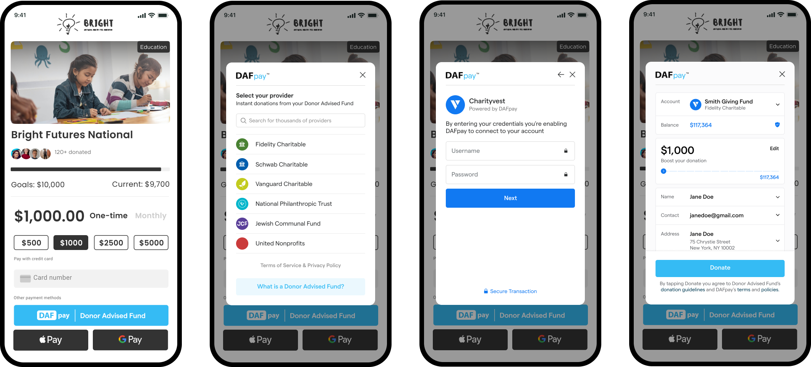

DAFpay is a payment option that allows donors to initiate grants from their donor advised funds directly on your donation pages.

<Frame>
    
</Frame>

Try out the [DAFpay Demo](https://secure.dafpay.com/demo) for yourself and see what it might look like on your website after you've completed the integration.

## How a DAFpay Gift Works

1. A donor clicks DAFpay on your form and signs in to their DAF provider.
2. The donor confirms the amount and authorizes a Grant request.
3. Your server calls Create Grant.
4. The DAF provider reviews the request and sends the funds.

## Find Your Use Case

1. **Enable DAFpay through a platform you already use**: If the platform already supports DAFpay you can enable it without a custom API build. See the [list of supported providers](https://www.givechariot.com/dafpay-setup#integration-search).
2. **Add DAFpay components to a web page**: You can embed HTML directly on your website to use the out of the box DAFpay components. See [Install DAFpay](/guides/dafpay/accept/install).
3. **Build a custom DAFpay integration**: Use the DAFpay APIs to build a custom integration on your donation form or on a platform that serves many nonprofits. See [Build a Custom Integration](/guides/dafpay/accept/api).
4. **Connect your DAF to DAFpay**: Use [Donor Accounts](/guides/dafpay/send/donor-accounts/overview) or the [OAuth integration](/guides/dafpay/send/oauth/overview) to enable your donors to submit grants through DAFpay.

## Key Terms

| Term | Definition |
| --- | --- |
| Connect | The DAFpay setup for one organization. Its ID tells Chariot which organization receives the gift. Organizations can have multiple Connects if they receive DAFpay from multiple places online. |
| Workflow session | A single DAFpay session. A new workflow session starts each time a donor clicks the DAFpay button, and you use its ID to create the Grant. |
| Grant | A grant initiated to a DAF provider, created via the Create Grant endpoint. |
| Donation | Donations represent gifts in Chariot and are only available to Chariot Deposit Account holders. Donations can be created from DAFpay gifts created via Create Grant, or other gifts that land in an organization's account from a Chariot disbursement partner or a connected payment source. [Processing Donations](/guides/dafpay/accept/processing-donations) covers the lifecycle of how a Grant becomes a Donation. |
